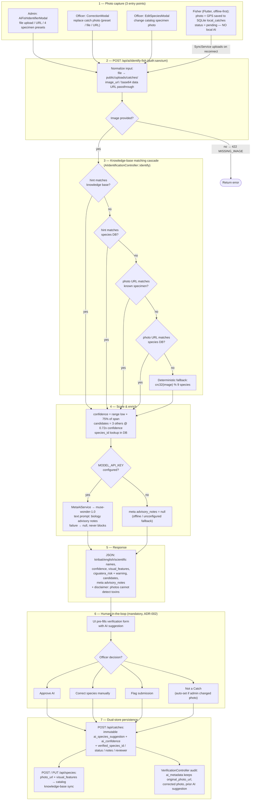

# AI Fish Species Identification — Flow

How the Kiribati AI Fisheries Assistant identifies a fish species from a
photograph, from capture to human-verified ground truth.

> Honest scope note (per ADR-009): the current "vision" step is a
> **server-side morphological knowledge-base matcher**, not a live image-model
> inference call. `muse-wonder-1.0` is text-only and contributes advisory notes.
> Photographs **cannot** detect ciguatoxins — every response carries that
> disclaimer, and every result requires human confirmation (ADR-002).

## Flowchart

## Step notes (code references)

| Step | What happens | Code |
|---|---|---|
| 1 | Admin uploads photo / picks preset with hint; fisher app queues offline with `sync_status='pending'` | `frontend/src/components/AiFishIdentifierModal.tsx`, `mobile/lib/services/sync/sync_service.dart` |
| 2 | Multipart file saved to `public/uploads/catches/`; URL/base64 passed through; 422 if empty | `backend/app/Http/Controllers/AiIdentificationController.php` → `identify()` |
| 3 | 9-species Kiribati knowledge base (`Te Bwere`, `Te Ingimea`, …) matched by hint → DB hint → photo URL → DB photo → `crc32` hash | `AiIdentificationController::$speciesKnowledgeBase` |
| 4 | Confidence from species `confidence_range`; Meta text model adds notes only when key configured | `backend/app/Services/MetaAiService.php` → `queryText()` |
| 5 | Response always includes toxin disclaimer | `identify()` return payload |
| 6–7 | Officer must Approve / Correct / Flag / Not-a-Catch with notes; original AI suggestion preserved immutably; admin-changed photo ⇒ `is_catch=false` | `backend/app/Http/Controllers/VerificationController.php`, `CorrectionModal.tsx` |

## Related endpoints

- `POST /api/ai/identify-fish` — identification (any authenticated user)
- `GET/POST /api/ai/meta-health` — Meta API probe, admin/reviewer only, key never exposed
- `POST /api/catches`, `POST /api/species`, `PUT /api/species/{id}` — persistence
- `POST /api/admin/catches/{id}/verify` — verification (admin/reviewer only)
