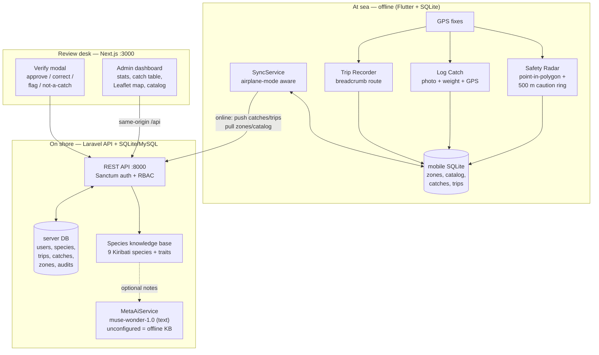

# System Architecture

Offline-first fisheries assistant: Flutter records everything locally at sea,
Laravel is the system of record on shore, Next.js is the officer review desk.
AI suggestions are advisory only — humans confirm every species (ADR-002).

## Data flow (happy path)

1. Fisher logs a catch offline → SQLite `local_catches` (`pending`).
2. Connectivity returns → `SyncService` uploads catch + photo ref, runs
   server-side AI identification, stores `ai_species_suggestion`.
3. Officer opens Next.js → sees photo, GPS, AI suggestion → approves or
   corrects (original AI text preserved immutably).
4. Trip breadcrumbs sync the same way; polylines render on the Leaflet map.
5. Advisory zones flow the opposite direction: admin draws → publishes →
   mobile caches → radar warns offline.

## Trust boundaries

- Fisher GPS is confidential: exact coordinates only for the owning fisher and
  officers (`GPS_PROTECTED`, redaction for others).
- `MODEL_API_KEY` never leaves the Laravel backend (bool-only exposure).
- Draft advisories never reach fishers; only admin-published zones sync.
- Photos never prove safety: every AI response carries the toxin disclaimer.

## Component map

| Area | Code | Store | Tests |
|---|---|---|---|
| API + auth + RBAC | `backend/app/Http/Controllers/` | SQLite demo / MySQL prod | 46 PHPUnit |
| AI identify + Meta service | `AiIdentificationController`, `MetaAiService` | Knowledge base + DB | `AiFishIdentificationTest`, `MetaAiServiceTest` |
| Advisories + GIS | `AdvisoryZoneController`, `PointInPolygonService` | `advisory_zones*` | `AdvisoryZoneApiTest` |
| Dashboard + review | `frontend/src/` (Next.js + Leaflet) | via API | production build |
| Offline GIS + alerts | `mobile/lib/services/gis/` | SQLite cache | 12 Dart tests |
| Offline catch + sync | `mobile/lib/services/sync/`, `LogCatchScreen` | `local_catches` | 8 Dart tests |
| Trip recording | `mobile/lib/services/trip/` | `local_trips*` | 6 Dart tests |
